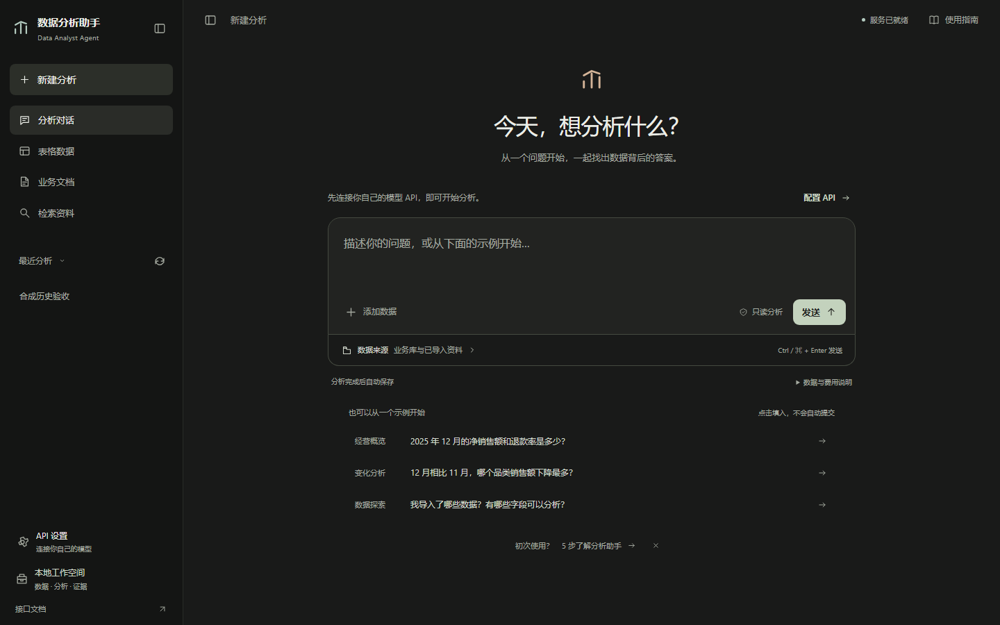
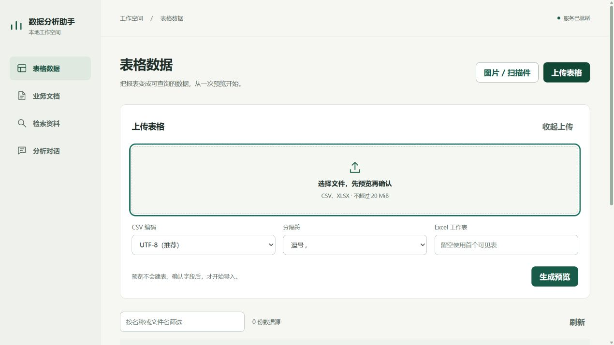
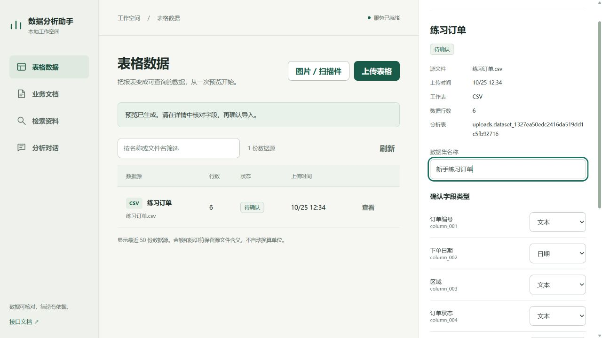
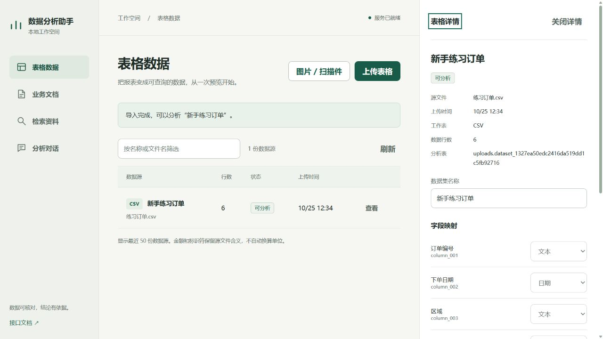
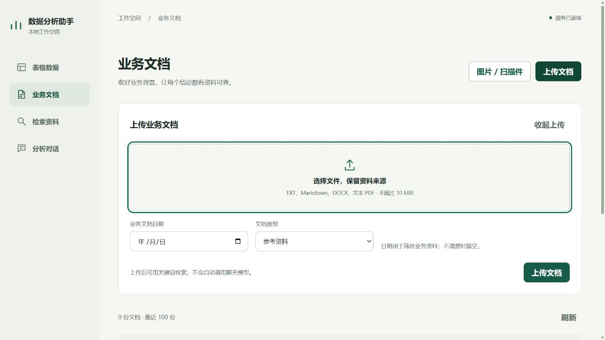
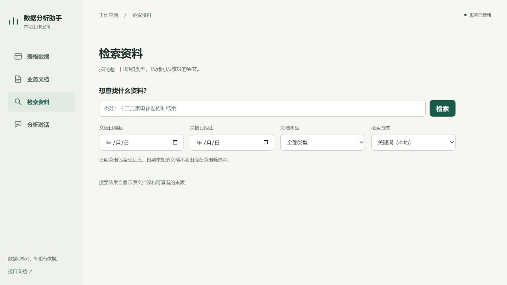
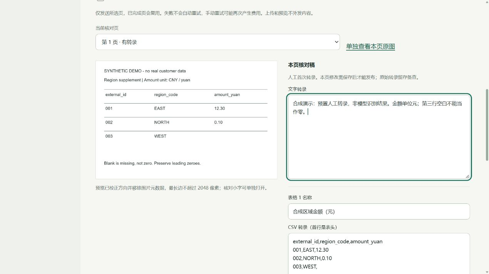
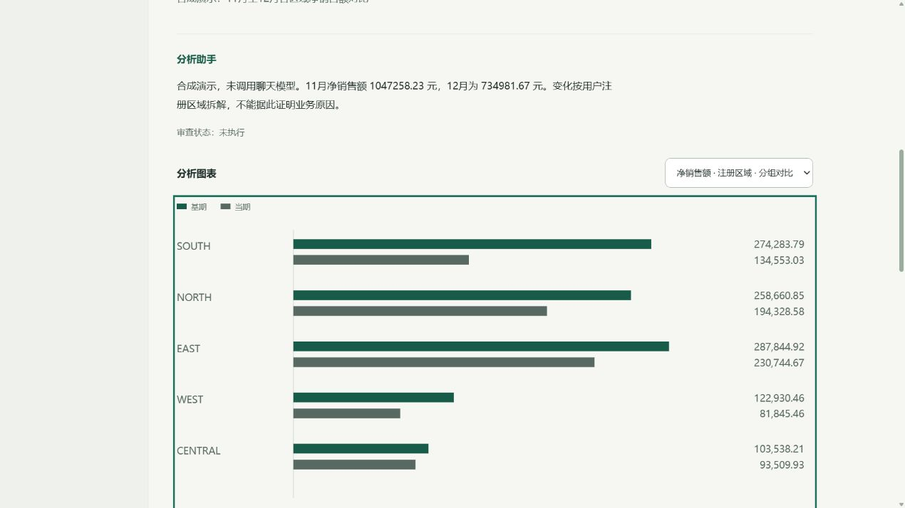
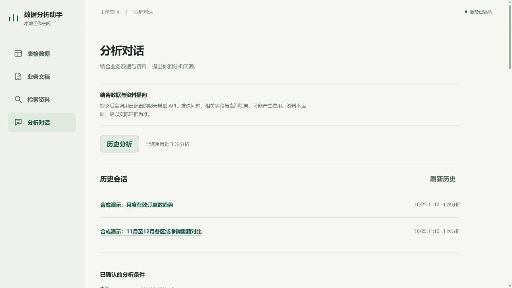
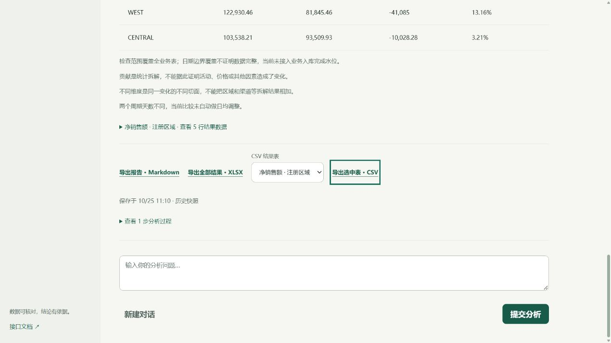

# 数据工作台使用指南

本指南带你用 `examples/` 下的练习文件走一遍工作台：导入表格、上传文档、检索资料、核对图片、提问分析、查看历史和导出。练习文件都是合成材料，不含真实用户信息。

需要接入自己的业务指标、核对程序校验或恢复中断任务时，见[核心分析指南](../core-analysis.md)。业务口径的三个 JSON 模板仅用于配置起步，需要替换为真实表和字段，不会自动修改数据。

## 开始之前

- **已在这台 Windows 电脑完成初始化：** 双击项目目录的 [`start-agent.cmd`](../../start-agent.cmd)。它会启动 Docker、等待 PostgreSQL 和 Redis 就绪，再启动工作台并打开 <http://127.0.0.1:18080/>。使用期间保持窗口打开，按 Ctrl+C 停止应用。
- 按 [README](../../README.md) 的"完整模式部署"准备好 PostgreSQL 并启动应用。只用 SQLite 最小模式时，工作台只能使用"分析工作台"，表格、文档和图片入口会显示服务未就绪。
- 打开 <http://127.0.0.1:8000/>（端口按你的启动命令）。右上角显示"服务已就绪"即可开始。
- 哪些操作会调用付费 API：
  - **会调用**："分析对话"里点"发送"（聊天模型）；启用 Embedding 后上传文档或选择向量/混合检索；图片勾选同意后点"识别所选页"。
  - **不会调用**：浏览列表、上传和预览表格、关键词检索、人工转录、打开历史分析、导出现有报告。
- 演示数据的年份是 2025 年。提问时请写明年月，例如"2025 年 12 月"。

练习文件：

| 文件 | 用途 |
|---|---|
| [练习订单.csv](examples/练习订单.csv) | 6 笔订单，用于导入表格 |
| [练习活动说明.md](examples/练习活动说明.md) | 统计口径与活动时间，用于上传文档和检索 |
| [练习图片.png](examples/练习图片.png)、[练习扫描件.pdf](examples/练习扫描件.pdf) | 同一份合成表格的图片和扫描件，用于图片核对 |
| [练习文件说明.txt](examples/练习文件说明.txt) | 练习的标准答案 |

## 1. 工作台概览

先在自己电脑运行 Agent，点击左侧“API 设置”，选择“聊天分析”，再选择供应商、填写自己的 Key，点击“获取模型”后从列表选择并保存。图片/OCR 和向量检索在同一窗口分别配置各自的模型和 Key。未配置时不会使用开发者 Key，发送时会打开设置并保留问题。保存不调用模型；主动测试可能计费。手机先打开左上角侧栏即可找到设置。完整步骤与索引切换说明见[模型设置指南](model-settings.md)。

打开工作台即可输入问题。首页的示例问题只填入输入框，确认并点击"发送"后才调用聊天模型。下文其余流程图来自较早版本，按钮位置与配色以当前页面为准。

第一次使用时，点击首页的"5 步了解分析助手"，或随时点击右上角"使用指南"。五步会带你了解演示体验、表格导入、准备资料、描述问题、核对结果与历史。可以跳过、收起或重看，不会自动提交问题；已输入的草稿不会被示例覆盖。跳过或完成会在当前浏览器记住；浏览器禁止本地存储时，下次打开可能再次看到邀请。

左侧主要入口：

- **表格数据**：上传 CSV/XLSX，确认字段后导入为可查询的表。
- **业务文档**：上传 TXT、Markdown、DOCX、文本 PDF，作为分析时可引用的资料。
- **检索资料**：按问题、日期和类型找到原文片段。
- **分析工作台**：用自然语言提问，查看结论、图表、证据和历史分析；也是默认首页。
- **分析任务**：查看实际执行阶段及尝试记录；恢复失败或中断任务前需确认重新查询和模型费用。
- **业务口径**：高级 JSON 配置表、字段、单位、粒度和筛选；保存新版本不调用模型。

左下角"接口文档"打开 `/docs`，可以直接调试接口。

## 2. 导入表格

1. 进入"表格数据"，点击右上角"上传表格"。
2. 选择 `练习订单.csv`。CSV 编码保持"UTF-8（推荐）"，分隔符选"逗号 ,"；Excel 文件可以填写工作表名，留空使用第一个可见表。
3. 点击"生成预览"。预览不会建表。

4. 右侧详情显示字段和推断类型。这一步要逐个核对：
   - `订单编号` 选"文本"，否则 `001` 会丢掉前导零。
   - `实付金额_元` 选精确小数。
   - `下单日期` 选"日期"。
   - 可以修改"数据集名称"，例如改成"新手练习订单"。

5. 点击"确认字段并导入"。状态依次变为"等待导入""正在导入""可分析"，进度条显示实际处理的行数。导入失败时会显示原因和"重试导入"。

导入后的表放在 `uploads` schema，Agent 用只读账号查询，也可以和演示业务表关联分析。金额和标识符保留源文件的含义，不会自动换算单位。

## 3. 上传业务文档

1. 进入"业务文档"，点击"上传文档"。
2. 选择 `练习活动说明.md`。
3. "业务文档日期"填文档对应的业务日期，不清楚时留空；"文档类型"按内容选择，例如"参考资料""活动复盘"。
4. 点击"上传文档"。

上传后立即可以做关键词检索。如果实例启用了 Embedding，上传后会在后台把文档发送给向量模型建立索引并计费；上传前先确认是否允许外发。

## 4. 检索资料

1. 进入"检索资料"，输入问题，例如"练习活动什么时候结束"。
2. 按需设置文档日期范围和类型。日期未知的文档不会出现在日期范围筛选结果中。
3. "检索方式"默认"关键词（本地）"，不调用任何 API；"向量检索"和"混合检索"需要启用 Embedding。
4. 点击"检索"。每条结果显示原文片段，点"查看原文来源"可以在右侧看到页码、章节和上下文。

## 5. 图片与扫描件

图片中的表格需要先变成可核对的文字，再进入查询。识别结果不等于事实，必须人工核对。

1. 在"表格数据"或"业务文档"点击"图片 / 扫描件"，选择 `练习图片.png` 或 `练习扫描件.pdf`，点击"上传到本地预览"。上传和预览只在本机进行。
2. 选择要处理的页：
   - **用视觉模型识别**：填写本次识别页码，勾选"同意将所选页图片发送至硅基流动进行识别，并承担相关 API 费用"，再点"识别所选页"。失败不会自动重试。
   - **人工转录**：不启用模型时，直接在"文字转录"里输入，点"添加人工转录表格"录入 CSV。
3. 对照左侧原图核对右侧的"文字转录"和"CSV 转录（首行是表头）"，修改后点"保存核对稿"。

4. 勾选"已核对当前页的数字、单位、表头和缺失值，确认转录内容"，然后选择：
   - "转为表格预览"：进入第 2 节的字段确认流程，确认后才导入。
   - "当前页转为参考资料"：保存为带原始页码的文档，默认只做本地关键词检索；另行勾选后才建立向量索引。

练习图片第三行金额是空白，表示缺失，不能补成 0。可辨认金额合计为 12.40 元。

## 6. 分析工作台

1. 进入"分析对话"，在居中的输入框中描述问题，例如：
   > 新手练习订单中，2025 年 12 月已完成订单的实付金额比 11 月变化了多少？按区域拆解。
2. 点击"发送"（或按 Ctrl / Command + Enter）。分析过程中按钮变为"停止分析"，正文显示简短状态；实际的工具执行和审查事件在“分析详情”中查看。对话开始后，输入框停留在底部，消息区独立滚动；查看旧回答时可点击“回到最新”恢复跟随。
3. 正文直接显示答案。点击该条回答右上角“分析详情”，可在右侧查看：
   - 结论和审查状态（通过、未通过、未执行或不可用）；
   - 本轮记录索引：点击 E 编号可展开并定位对应的工具调用；失败的记录也会保留，不等于已核验通过；
   - 分析图表，可在右上角下拉框切换；
   - 结果数据表、统计范围和限制说明；
   - 引用的文档片段（点击可查看原文）；
   - "查看 N 步分析过程"，展开后能看到每一次工具调用和 SQL。
4. 口径不明确时，Agent 会先提出需要核对的问题，补充后再继续。继续追问时直接输入，例如"那华北呢？"。点击导航栏的"新建分析"开始一个不带上下文的新会话。

用练习文件核对答案：12 月已完成订单合计 175.50 元，11 月 200.50 元，减少 25.00 元（约 -12.47%），其中华东 -20.50 元、华北 -4.50 元。已退款订单不计入。模型给出的数字是否正确，要看当次查询结果和审查结论，不要只看结论文字。

贡献拆解是统计意义上的分解，不能单独证明是活动结束等原因造成了变化。

## 7. 历史分析与导出

1. 在左侧“最近分析”中点击会话标题即可恢复；手机上先点击左上角侧栏按钮。刷新页面后也会自动恢复上次的会话。
2. 如果会话中有已确认的分析条件（数据来源、指标、周期、筛选），可在“分析详情”中展开“当前会话条件”。后续追问会沿用这些条件，但数字会重新查询。上传可从左栏进入，也可从输入框的“添加数据”进入。

3. 在对应回答的“分析详情”中可以导出：
   - "导出报告 · Markdown"：结论、结果表、限制说明和工具证据。
   - "导出全部结果 · XLSX"：所有结果表和完整查询记录。
   - "导出选中表 · CSV"：先在"CSV 结果表"中选择一张表。

打开历史和导出不会重新调用模型或重跑 SQL。审查未通过的报告仍可查看，但不会作为后续追问的可信条件。

4. 如果你核对过这份报告的 SQL 确实正确，可以点"SQL 正确，存为示例"。以后有人问同类问题时，Agent 会参考这条 SQL 的写法，但仍会重新查询，不会直接引用其中的数字。审查未通过的报告不显示这个按钮。

## 常见问题

| 现象 | 处理 |
|---|---|
| 表格、文档入口提示服务未就绪 | PostgreSQL 没有连上或没有执行迁移，按 README"完整模式部署"检查；`/api/v1/health/ready` 会给出原因 |
| 导入失败 | 详情中会显示原因，修正源文件或字段类型后点"重试导入" |
| 向量检索、混合检索不可选 | 未启用 Embedding，改用"关键词（本地）" |
| 图片无法识别 | 视觉模型未启用，可直接人工转录 |
| 历史分析入口不显示 | 分析历史存储未就绪，问答仍可用，但不会保存报告 |
| 提交后提示会话存储不可用 | 使用 Redis 会话时 Redis 未启动；启动 Redis 或改回 `SESSION_BACKEND=memory` |
| `15432 Connection refused`、Redis 超时，且文档和历史不可用 | Docker 或数据库容器未运行。在原应用窗口按 Ctrl+C，双击 `start-agent.cmd`，等待依赖和工作台就绪后刷新；数据库恢复后还需重启应用以重新启用启动时被关闭的模块 |
